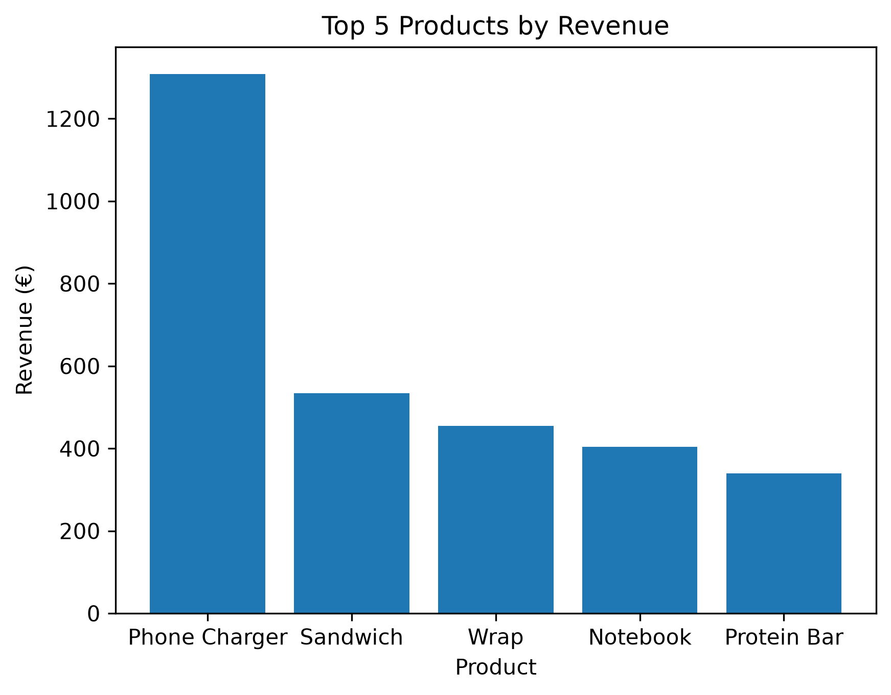

# Retail Sales Analysis — Python & Pandas

## Project Overview
This project analyses 300 simulated retail transactions across three stores during July and August 2026.

The goal is to understand store performance, identify top-selling products, and explore opportunities to improve sales.

## Technologies Used
- Python
- Pandas
- Matplotlib
- VS Code

## Key Findings
- **Total Revenue:** €3,981.40
- **Best Performing Store:** Southside (€1,487.80)
- **Highest Revenue Product:** Phone Charger (€1,308.00)
- **Revenue Concentration:** Phone Chargers contributed approximately 32.9% of total revenue.

## Business Recommendations
1. Investigate why Southside performs better than the other stores.
2. Explore complementary products such as power banks and wall plugs to diversify revenue.
3. Test impulse-purchase products near checkout counters to potentially increase average transaction value.

## Visualization

## Dataset
The dataset contains fictional retail transactions created for educational purposes.